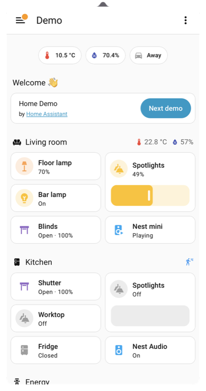

# HA Menubar

Your Home Assistant dashboard in a macOS menu bar popover, one click away. It is a live web view of the real dashboard, so every card, pop-up and hold gesture works as in the browser.



- Left-click the house icon (or a global shortcut): dashboard, kept connected so it opens instantly
- Right-click: switch dashboards, Reload, Open in Browser, Keep Open, Settings, Launch at Login, About, Quit
- Several dashboards; a remote URL (e.g. Nabu Casa) tried when home is unreachable
- Phone, tablet or wide size, zoom 75–125%
- Clear "Can't reach Home Assistant" screen and a crossed-out icon when offline; reloads once the network is back after sleep
- Self-signed HTTPS: asks once per server and pins the certificate fingerprint
- No token stored: you log in on Home Assistant's own page once and the session is kept

Requires macOS 14+.

## Install

Download `HAMenubar.zip` from [Releases](../../releases), unzip, move `HAMenubar.app` to Applications. The app is not notarized, so clear the quarantine flag once:

```sh
xattr -dr com.apple.quarantine /Applications/HAMenubar.app
```

Or build it yourself (Xcode Command Line Tools are enough):

```sh
make app      # build/HAMenubar.app
make run      # build and launch
```

## Setup

On first launch, paste your dashboard URL, e.g. `http://homeassistant.local:8123/lovelace/0`, or just the server URL for the default dashboard. Then click the icon and log in. For several dashboards, add one per line with an optional name:

```
Home    | http://homeassistant.local:8123/lovelace/0
Energy  | http://homeassistant.local:8123/energy
```
